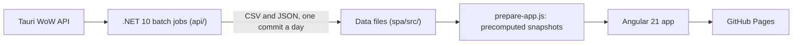

# Tauri Achievements

**Live rankings, raid logs and Mythic+ ladders for the Tauri WoW community.**

[](https://github.com/tauriachievements/tauriachievements.github.io/actions/workflows/static1.yml)
[](https://github.com/tauriachievements/tauriachievements.github.io/actions/workflows/api-ci.yml)

[Open the site](https://tauriachievements.github.io/) · [Join the Discord](https://discord.gg/JMHnDmh2bP)

Tauri Achievements ranks more than 200,000 characters across the Evermoon, Tauri and Warriors of
Darkness realms of the Tauri World of Warcraft server. It started as a single leaderboard and now
covers raids, Mythic+ and PvP. The data is refreshed every day.

## Why it exists

For years, Tauri Ladder was where players checked their standing on the realm. After the Legion
expansion it stopped updating. New achievements kept arriving, but the rankings froze, and players
had no reliable way to see where they stood.

Tauri Achievements brings that ladder back, keeps it current, and adds what the community asked
for next.

## The community so far

The site launched in February 2026. From February 1 to October 28, 2026:

| Active users | Page views | Sessions | Engagement rate |
| ---: | ---: | ---: | ---: |
| 4,746 | 161,826 | 28,158 | 68.59% |

Growth has sped up in recent months. October's active users were already more than three times
September's before the month was over:

| Month | Active users |
| --- | ---: |
| August | 711 |
| September | 1,188 |
| October 1–28 | 3,803 |

The ladder is the flagship page, with nearly 157,000 views. Of the 28,158 sessions, 23,241 came
straight to the site, by name or bookmark.

Players visit from across Europe, North America and beyond. Hungary has a particularly loyal
audience, the United Kingdom grew sharply in October, and the United States, Serbia, Poland,
Romania, Colombia, Russia and Germany round out the list.

## What's on the site

| Section | What you'll find |
| --- | --- |
| Ladder | Players ranked by achievement points or honorable kills, daily top gainers, side-by-side character comparison, guild rankings |
| Achievements | Rare achievements and who holds them, newly discovered rare characters, the Hall of Fame |
| PvP | 2v2 and 3v3 arena ladders, battleground activity, rated battlegrounds |
| Raids | Emerald Nightmare logs, guild progression, character rankings, a spec tier list, talent analytics, realm-first history |
| Mythic+ | Scored leaderboards with character and guild pages, statistics, records, and the LegionKeyHistory addon |
| Realm Stats | Class, race and faction balance, item level and time played across the realms |

## How it works

There is no server and no database. Daily .NET batch jobs read the Tauri API and write the data as
files into the repository. Each daily refresh is one `sync data` commit, and every push to `main`
rebuilds the site and deploys it to GitHub Pages.



A few decisions shape the code:

- **Heavy work happens at build time.** The ladder's 200,000-row CSV is parsed once per build into
  precomputed snapshots, so pages don't crunch the full ladder in the browser. Daily rank changes
  come from the git history of `Players.csv`.
- **Data is cached until it changes.** A content-hashed manifest lets browsers keep each data file
  until a refresh actually changes it.
- **A bad run never publishes.** Each exporter publishes all of its output or none of it, and
  refuses to publish when its output shrinks suspiciously, which usually means the API was having a
  bad day.
- **Phones come first.** Many players visit on a phone. A layout check opens every page at 320 to
  412 px and fails if anything scrolls sideways.

**Stack:** Angular 21 (standalone components, signals, zoneless), TypeScript and SCSS, with Angular
and RxJS as the only runtime dependencies; Vitest and Playwright for tests. .NET 10, C# and xUnit
for the data jobs. GitHub Actions and GitHub Pages for CI and hosting.

## Repository layout

| Folder | Contents |
| --- | --- |
| [`spa/`](spa/) | The Angular app, its data files and the build scripts |
| [`api/`](api/) | .NET console jobs that collect and export the data, shared code in `Tauri.Core`, tests in `tests/` |
| [`docs/`](docs/) | Topic docs (data pipeline, frontend, scoring, Tauri API, testing) and how-to guides |
| [`.github/workflows/`](.github/workflows/) | Deploy, pull request checks and API CI |

## Getting started

**Frontend** (Node.js 20.19+, 22.12+ or 24, npm 10+):

```powershell
cd spa
npm install
npm start      # http://localhost:4200
npm test
```

**Data jobs** (.NET 10 SDK; the jobs that call the API need Tauri API credentials):

```powershell
cd api
dotnet tool restore
dotnet build AchievementLadder.sln
dotnet test AchievementLadder.sln
```

[`spa/README.md`](spa/README.md) and [`api/README.md`](api/README.md) go deeper into each half,
including every job and the daily update.

## Contributing

Read [`AGENTS.md`](AGENTS.md) first. It holds the working rules for people and AI coding agents
alike: test first, phones first, and ask before architectural changes. The topic docs and how-to
guides in [`docs/`](docs/) cover the rest, from
[adding a page](docs/guides/howto-add-page.md) to
[adding an exporter](docs/guides/howto-add-exporter.md).

## Feedback

Ideas, bug reports and feedback are always welcome. Open an issue, join the
[Discord](https://discord.gg/JMHnDmh2bP), or message `xyhop4823` on Discord.

## License

MIT
